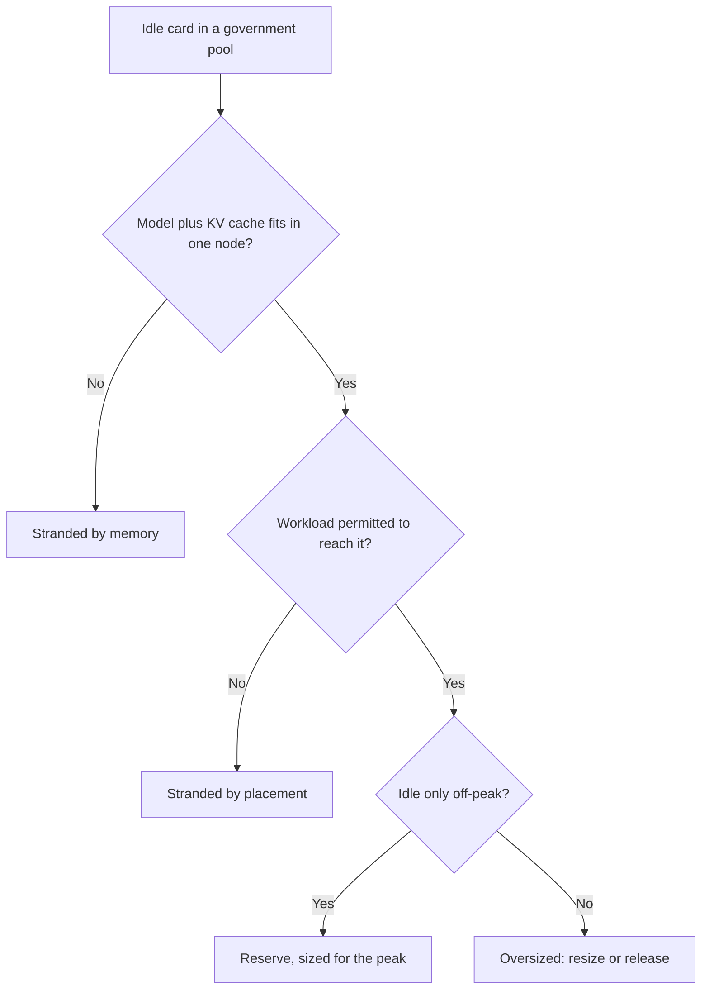

How does a provincial data bureau tell an accelerator it is holding in reserve from one that is simply stranded? Picture the engineer who runs the pool behind a 12345 citizen hotline, looking at a monitoring screen late on a Sunday. Rows of cards are doing nothing. Some will be needed when the working week opens and residents start calling about heating bills and pensions. Some will never be needed again. On the screen they are the same colour.

China's national argument about computing power has settled on a measure that cannot tell them apart. On 20 October the Ministry of Industry and Information Technology told a State Council Information Office briefing that the country's intelligent computing capacity had reached [2,592 EFLOPS at the end of September, up 146 percent in a year](https://www.news.cn/tech/20261020/f97a5ecec1f84f9082ecd974a5dc9663/c.html). On 26 October Guo Jin of the Shanghai Academy of Social Sciences supplied the companion figure in Yicai: [national utilisation of intelligent compute at 36.8 percent, with more than 60 percent of it idle](https://m.yicai.com/news/103409871.html). The two numbers now travel together.

A utilisation ratio is an accounting unit. It counts a card that can no longer load the model it was bought for and a card waiting for Monday's queue identically, and for a public-sector owner those two cards call for opposite decisions. One belongs in a write-down. The other is doing the job it was sized for.

Start with where government inference may run, because in China that is written down. The guideline on large models in government affairs, [published on 10 October 2025](https://www.cac.gov.cn/2025-10/10/c_1761819469929310.htm) by the Office of the Central Cyberspace Affairs Commission with the National Development and Reform Commission, sets the hierarchy. Prefecture-level cities deploy under their province's unified requirements. Counties and below "should in principle reuse the intelligent computing and model resources of the level above" and stop building government models of their own. Services run inside the e-government extranet, classified material stays off networked models, and the preferred pattern is "built in one place, reused by many places and departments." The monitoring clause asks agencies to track running state, response time, accuracy, security and risk in real time. Utilisation does not appear on the list.

Liaoning's provincial 12345 hotline shows the hierarchy working. The platform began an internal trial with DeepSeek on 23 January 2025, one of several hotlines, Jiangmen's among them, that [announced integrations in February 2025](https://china.cnr.cn/gdgg/20250224/t20250224_527080439.shtml). By June 2026 its "Xiaoning" service, built on a rule that data does not leave its domain, had cleared the Cyberspace Administration of China's filing regime and been extended to five municipal platforms and six county-level districts; the provincial government's own account credits it with [a 25 percent gain in processing efficiency and a 30 percent cut in response time](https://www.fuxin.gov.cn/content/2026/1074194.html). One provincial model, reused downward: the guideline's design, running. No baseline or method has been published, so I read both percentages as claims.

Other cities are building the same shape. The Beijing Municipal Big Data Center's government model platform, launched in September 2026, is meant to [create a single citywide compute pool](https://news.qq.com/rain/a/20260913A05JUJ00), with the city's complaint-handling system among its core scenarios. Shenzhen's plan, issued in March 2026, targets [100 percent "unified management" of government-service model applications by 2027](https://sz.cnr.cn/gstjsz/20260303/t20260303_527541848.shtml). The evaluation series the China Academy of Information and Communications Technology opened in February 2026 grades government hotline models on [construction level and application effectiveness](https://m.thepaper.cn/newsDetail_forward_32531215). Each of these documents tracks service. The national debate tracks volume. Neither tracks fit, which is where stranding happens.

Fit begins with the model. DeepSeek-V3, the base under the R1 reasoning model that Jiangmen's hotline put onto its government cloud, carries [671 billion parameters, 37 billion of them active for each token](https://arxiv.org/abs/2412.19437), according to its December 2024 technical report. The family DeepSeek released on 24 April 2026 comes in two sizes: [V4-Pro at 1.6 trillion parameters with 49 billion active, and V4-Flash at 285 billion with 13 billion active](https://fe-static.deepseek.com/chat/transparency/deepseek-V4-model-card-EN.pdf).

Now set those sizes against a [Securities Times report of 29 September](https://stcn.com/article/detail/4201678.html): idle capacity is concentrated in older domestic cards that "generally have only 64GB of memory" and cannot keep pace with growing model sizes, while utilisation of the 144GB cards launched in 2026 has surged. The same report carries [the National Data Administration's count](https://stcn.com/article/detail/4201678.html) of more than 500 intelligent computing centres in use by June and nearly 400 under construction or planned. It describes centres built by local investment vehicles and state platforms on a "build first, look for demand later" basis, and some less-developed regions buying immature low-end chips to meet localisation targets.

My arithmetic, from the published counts, explains the split. At one byte per parameter, V3's weights come to about 671 gigabytes. A typical eight-card server of 64-gigabyte cards holds 512. The model does not fit; it must be squeezed to roughly four bits per weight, or split across two servers so that every decoding step crosses the network between them. Eight 144-gigabyte cards hold 1,152 gigabytes: V3 at eight bits with about 480 to spare, or V4-Pro at around four bits with about 350. V4-Flash at eight bits needs about 285 gigabytes and sits comfortably inside the older server.

Memory decides more than whether a model loads. At the batch sizes a hotline sees, generating each token is limited by memory bandwidth more than by arithmetic, so bandwidth utilisation sets how quickly a pool answers, and an exaflops total says little about it. Whatever memory remains after the weights becomes KV cache, and KV cache is concurrency: every resident with an open conversation occupies a slice. DeepSeek has spent two generations shrinking that slice, compressing the cache into a latent vector in V3 and along the sequence dimension in V4. The capacity that matters to a hotline is the number of conversations a pool can hold at nine on a Monday inside its response-time target.

Which returns us to the Sunday screen. Most residents call in working hours. A pool sized so the Monday queue stays inside the response time the guideline tells agencies to watch will sit partly idle every night and weekend; that idle time is what the service costs. On a utilisation ratio, the correctly sized pool looks wasteful and the undersized one looks efficient, until the morning its queue backs up.

Sorting the screen takes three questions, and their order matters:

Guo's Yicai piece is the strongest statement of the opposing case, and much of it is right. He describes localities still running compute centres "on the real estate development model," building machine rooms and waiting for tenants. His remedies are structural: extend the "1+M+N" interconnection platforms, build a nationally unified compute trading market, invest in interoperability across domestic chips, and restructure centres into commercial operators on the pattern of the national grid and railways. Taken together, they treat idle capacity as a matching and management problem that open markets and commercial discipline would cure.

For commercial training and batch work, I agree with him. Those jobs can travel to wherever capacity is cheap. Government inference cannot, by design. The guideline keeps it inside the e-government extranet and inside the administrative hierarchy; Liaoning's counties reuse Liaoning's model. Guo's own figures cut both ways: training, the work that travels well, is [about a quarter of intelligent compute, and network delay from some regions to Shanghai runs as high as 100 milliseconds](https://m.yicai.com/news/103409871.html). An agent pays that toll on every call it chains. And no market changes the memory in a server. A 512-gigabyte node remains a Flash-class machine whoever rents it.

So my view is plain. Routing government inference onto whatever capacity sits idle, to lift a national utilisation figure, would be a mistake: it treats a fit problem as a volume problem. Before any province subsidises or writes off a cluster, it should publish two numbers per pool. The first is the largest model class that fits in one node with room for its KV cache at expected peak load. The second is response time at the busiest hour of the past quarter. The first separates stranded cards from usable ones; the second separates reserve from waste. Card-hours can stay in the national statistics.

The case for getting the shape right this year sits in a procurement notice from Beijing's Changping district. On 30 October the district renewed its government cloud by single-source award to Huawei Cloud, RMB 14.45 million for the two months to 31 December, and [the award notice](https://ggzyfw.beijing.gov.cn/jyxxzbjggg/20261030/5768417.html) is candid about the reason: the cloud "has been running for nine years" and hosts every government information system the district has funded, so continuity, data security and compatibility come first. Public infrastructure gets renewed far more often than it gets replaced. The provincial inference pools being assembled under the 2025 guideline will be renewed the same way, carrying whatever memory per node they are built with now.

The 64-gigabyte generation was overtaken by models that grew faster than its memory, and V4-Pro already fills most of a 144-gigabyte server even at four bits. When the next generation outgrows that server as well, and the pool sits inside a renewal written for continuity, who in a province like Liaoning will decide whether those cards are reserve, stranded, or still useful for smaller models, and whose budget will carry the answer?

---

*Tarry Singh is the founder and CEO of [Real AI](https://realai.eu), an enterprise AI advisory and deployment firm working with global enterprises on production agent systems, model risk, and AI sovereignty strategy. He also leads [Earthscan](https://earthscan.io) for Energy AI startup, and is a founding contributor to the EU-funded HCAIM and PANORAIMA programmes for responsible AI education across European universities. He writes at [tarrysingh.com](https://tarrysingh.com).*
