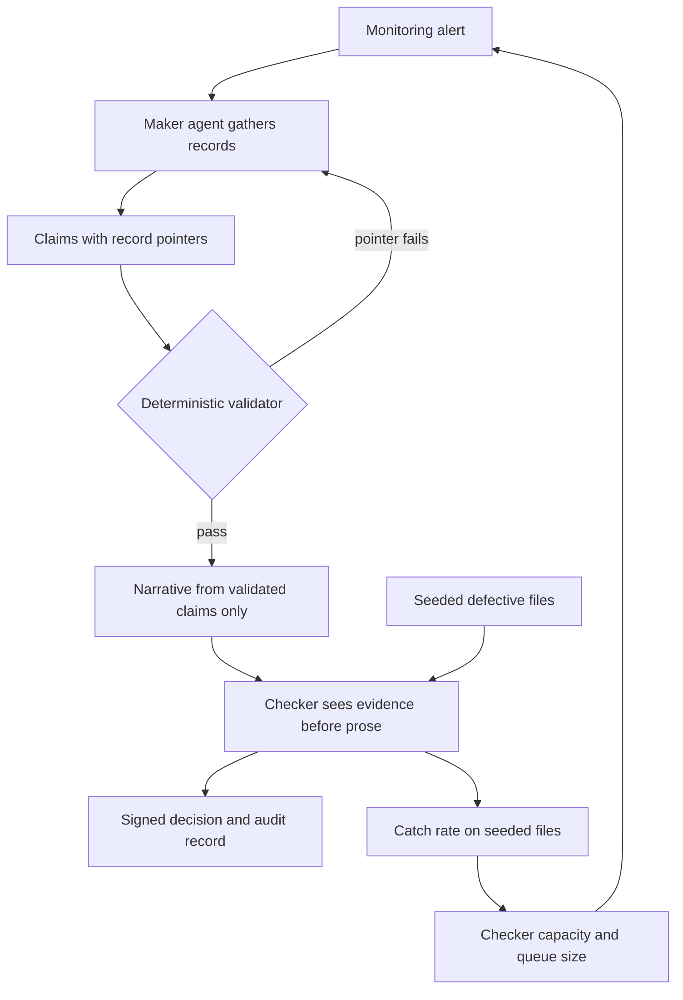

[One hundred and eighty million euros](https://www.prosecutionservice.nl/latest/news/2021/04/19/abn-amro-pays-eur-480-million-on-account-of-serious-shortcomings-in-money-laundering-prevention). That was the part of the settlement that was not a fine. Prosecutors worked it out from the personnel costs the bank had saved by not staffing its own checks properly, and they took the money back. The figure is a price, set by prosecutors and accepted by the bank, for a missing second pair of eyes.

The bank was ABN AMRO, and the date was 19 April 2021. The Dutch Public Prosecution Service's settlement totalled €480 million: €300 million in fine, €180 million in disgorgement. Three years earlier ING had settled for €775 million, and [the same office's account of that case](https://www.prosecutionservice.nl/latest/news/2018/09/04/ing-pays-775-million-due-to-serious-shortcomings-in-money-laundering-prevention) carries a €100 million disgorgement built the same way, from what the bank had saved over several years on compliance personnel. Two of the three largest Dutch banks, two settlements, and in both the state itemised the cost of checkers that were never hired.

On 2 October 2026, [ABN AMRO announced a six-month pilot](https://www.abnamro.com/en/news/abn-amro-explores-ai-agents-for-tackling-financial-crime-with-wonderful) with the AI company Wonderful to test whether agents can collect information, prepare case files and support data quality checks in its Detecting Financial Crime and Customer Data Solutions units. The release describes agents "operating within clearly defined boundaries and under human oversight," and says the bank will evaluate factors such as reliability and the human oversight needed. That second clause is the whole essay. The design question for every European bank putting agents near a financial-crime queue is the oldest control in banking, restated for software: who is the checker, and how would anyone know the checker is checking?

## Note on a settlement paragraph

The 2021 statement is worth reading as an engineering document, because it describes two failure modes that an agentic case pipeline can reproduce at much higher speed.

The first is volume. The transaction monitoring system, prosecutors wrote, "structurally generated more alerts than the staff were able to handle," and the bank carried an alert backlog for several years. ING's version was the mirror image: its system was configured so that "only a limited number of money laundering signals were generated," partly because of limited staff, and some alerts that did fire were set aside as "not unusual" almost without investigation. One bank drowned its checkers. The other throttled the inputs so the checkers would not drown, and still set aside some of what was left almost unexamined. Both are capacity failures at the checking step.

The second failure is quieter. About 5.5 million Mass Retail clients at ABN AMRO were placed in the lowest risk category, "00 neutral," on the basis of an automated analysis of identity data. No model in the modern sense, just a rule that sorted millions of people into a bucket that meant no one looked again unless an event forced it. In the prosecutors' examples, a client whose profile said low-risk employee moved more than €4.3 million through a personal account in nine months with no monitoring alert. The machine made a decision and the organisation treated it as a fact.

Volume and unchecked automation. Keep both in mind, because an agent that writes case files touches both at once: it can make far more files than any team can read, and it can phrase its own guesses in the confident register of a finished document.

## Note from the pilot announcement, 2 October

Read narrowly, the ABN AMRO pilot is sensible. It sits in an experimentation environment, under the Innovation team, scoped to information gathering and file preparation rather than disposition. Yorick Naeff, the bank's Head of Innovation, is quoted saying that AI's potential "becomes tangible when we put it to work in real processes." Fair enough. Nothing in the release suggests the agent will decide whether to file a report with the FIU.

Read against the bank's plans, it carries more weight. At its November 2025 Capital Markets Day, [ABN AMRO set a net reduction of 5,200 FTEs by 2028](https://www.abnamro.com/en/news/abn-amro-presents-roadmap-for-profitable-growth-and-new-financial-targets) against 2024, with "AI embedded" listed under right-sizing the cost base. A month earlier, [DutchNews, summarising a Financieele Dagblad report of 3 October 2025](https://www.dutchnews.nl/2025/10/banks-expect-to-cut-2600-money-laundering-check-jobs-fd), said Dutch banks expected to shed about 2,600 of roughly 13,000 anti-money-laundering jobs within two years, with analysts "only needed to verify results." I have not been able to read the FD original, so treat the per-sector figures as second-hand. The quote attributed there to Jaap van der Molen, ABN AMRO's head of financial crime, is the line I keep coming back to: "On paper you could build an entire case file with AI."

He is right, on paper. The pattern question is what happens on the other side of that paper.

Spain gives a contrast from the same month. On 28 October, [Banco Sabadell selected T-Systems' agentic platform](https://news.europawire.eu/banco-sabadell-selects-t-systems-platform-to-embed-sovereign-agentic-ai-across-banking-operations/eu-press-release/2026/10/28/16/19/06/184749/) to manage agents across the group's processes and entities. The release talks about "consistent security, governance and oversight" and model independence, and it describes no human control point at all. That is normal for a platform announcement, and I would not read malice into it. It does show where the industry's attention sits: on orchestrating many agents, much less on the narrow, unglamorous step where one person signs one file.

## Field note: what the maker should write

Banks already have a name for the pattern they need. Maker-checker, the four-eyes principle: one person prepares, a second person who did not prepare it approves, and the approval is recorded. It has governed payments, limit changes and journal entries for as long as I have worked near a bank. Applied to agents, the maker is the software and the checker is a person. The engineering work is to make the maker's output checkable at a cost the checker can afford.

That changes what a case file is. A narrative case file, the kind an analyst writes today, is prose with evidence attached. An agent-built file should invert that. The unit of output is the claim, and every claim carries a pointer:

- the assertion, in one sentence ("UBO of Company X is Person Y");
- the source system and the record identifier it came from;
- a hash or extract of the field as it was read;
- the timestamp of retrieval;
- a flag for whether the claim is a direct read or an inference the agent drew from several reads.

A deterministic validator, plain code with no model in it, then re-resolves every pointer and rejects any file where a claim does not match its record. Only after the claims pass does anything write a narrative, and the narrative may only restate validated claims. Evidence first, prose last. This costs some latency and an unpleasant schema migration. It removes the most dangerous thing a language model does in this setting, which is to produce a fluent sentence that sounds like it came from the KYC system when it came from the model.

The inference flag matters more than it looks. "Person Y controls Company X" read directly from a registry extract is one kind of claim. "Person Y is probably the effective controller, given the shared address and the director overlap" is another, and it is exactly the kind of judgement that belongs to the checker. A file that blurs the two quietly moves a judgement from the checker to the model.

This is an anecdote day, so one of them. In a Real AI engagement with a Tier-1 bank last year, we ran a small trial of model-drafted alert summaries against analyst-written ones. The drafts were good. The finding that mattered came from watching the reviewers: when the summary sat above the evidence on screen, review time fell and so did the rate at which reviewers changed anything. When we moved the evidence above the summary, review time rose a little and the change rate came back. Same people, same model. The layout decided how much checking happened.

## Field note: what the checker is shown

The checker's screen is a control surface, and it should be designed like one. Three rules follow from the trial above and from the literature.

First, show the claims and their source records before showing any narrative. Anchoring on a well-written paragraph is the failure, so delay the paragraph.

Second, separate direct reads from inferences visually, and require the checker to accept or reject each inference individually. Accepting a whole file with one click is the software version of the "not unusual" dispositions in the ING case, which needed no model at all.

Third, never let the checker be the same kind of system as the maker. This is my stake, and I hold it firmly: I would not sign off on a four-eyes control in which the second pair of eyes belongs to the same model family as the first. A second agent can be useful as a filter that routes files, and a rules engine can be a fine checker for the deterministic parts. A model reviewing its own family's output does not count as the second signature.

The research behind that position is not new. [Jie Huang and colleagues](https://arxiv.org/abs/2310.01798v2), in work presented at ICLR 2024, found that large language models struggle to correct their own reasoning without external feedback, and that performance sometimes falls after a self-correction pass. A critic agent prompted to find errors in a sibling's case file is close to that setting: no new information, the same blind spots. The European AI Act at least names the human version of the problem. [Article 14(4)(b)](https://ai-act-service-desk.ec.europa.eu/en/ai-act/article-14) requires that people overseeing high-risk systems are enabled "to remain aware of the possible tendency of automatically relying or over-relying on the output," and puts "(automation bias)" in brackets for emphasis. Awareness is a start. It is also not a measurement.

## Note on McKinsey's twenty-to-one

The best-argued published case against my position comes from [McKinsey's August 2025 piece on agentic AI in financial crime](https://www.mckinsey.com/capabilities/risk-and-resilience/our-insights/is-agentic-ai-a-financial-crime-game-changer), by Alexander Verhagen and colleagues. It describes a KYC workflow built from ten squads of four or five agents, each squad including a critic or validation agent, and says a human practitioner can typically supervise 20 or more agent workers, with manual intervention kept below 15 to 20 percent of cases. It puts productivity gains for the agentic model at "anywhere from 200 to 2,000 percent," on the authors' experience.

Take the argument at its best, because part of it is correct. The Dutch settlements show that putting a human on every step does not produce control; it produced backlogs and rubber stamps. A design that reserves people for exceptions and escalations is aiming at the right problem. The QA agent in each squad will catch many formatting and completeness errors cheaply. And a full audit trail of agent interactions, which the piece describes, is better than the paper trail most banks had in 2016.

Where I part company is on what the ratio is. In the McKinsey framing, 20-to-1 reads as a design input: you staff to it. I think it can only be an output, measured per queue, per quarter, because the thing it depends on is whether those humans still catch what they should, and nothing in the squad design measures that. A critic agent from the same model family is not evidence of catch rate (see Huang above). The 200-to-2,000 percent figure is a consultancy's estimate from its own engagements, not an instrumented result anyone outside can test, and a range that wide is telling you the denominator varies more than the method does. The 15-to-20 percent intervention ceiling is the part that worries me most. A ceiling on how often humans intervene is, from the outside, indistinguishable from ING's configured limit on how many signals the system generated. Different decade, same shape: capacity sets the threshold, and the threshold sets what gets seen.

[Ben Green's survey of 41 human-oversight policies](https://arxiv.org/abs/2109.05067), published in 2022, gets to the institutional version of this. He concluded that "evidence suggests that people are unable to perform the desired oversight functions," and that the policies can "provide a false sense of security." His remedy is that any proposed form of human oversight be supported by empirical evidence before an algorithm goes in. Banks do not need a new statute to do that. They need a test.

## Note on seeding the pile

The test is old as well. Airport security screeners are tested with planted images; software teams use mutation testing to check that their test suites fail when they should. Apply it to the case queue: inject a small, known share of deliberately defective files, built by a separate team, into the checker's workflow. A beneficial owner swapped. A cash deposit series dropped from the transaction extract. An inference flagged as a direct read. Then measure, per checker and per queue, how many get caught.

That one number does several jobs. It tells the bank whether its four-eyes control works, a question a policy binder cannot answer. It makes the staffing ratio an empirical claim: if catch rates hold at one queue depth and collapse at double it, the bank has learned its real capacity, and it learned it before a prosecutor did. It gives the supervisor something better than a policy document. [DNB's 2019 principles for AI in the financial sector](https://www.dnb.nl/media/jkbip2jc/general-principles-for-the-use-of-artificial-intelligence-in-the-financial-sector.pdf) already ask that material AI systems be designed with "human-in-the-loop" or "human-on-the-loop" review, that final accountability be assigned, and that outcomes be "sufficiently traceable and explainable." A seeded catch rate is how you show the loop has a human in it who is awake.

There are real costs. Seeded files must never reach the FIU, so they need a marker the checker cannot see and the reporting pipeline cannot miss, which means the audit trail carries a field the analyst's screen does not. Analysts will dislike being tested, and the results have to be used to size queues rather than to discipline individuals, or people will learn to over-reject and the measurement breaks. Building good defects takes skilled investigators, the very people the cost plan is trying to reduce. That last cost is the point. Some of the 2,600 roles should become the people who build the seeds.

The second recollection, then I will stop with them. Early in my career I spent time around a payments operation where every high-value instruction carried two sets of initials. One supervisor initialled faster than anyone else on the floor. Audit only noticed when someone pulled a week of instructions and found he had approved one with the beneficiary account field blank. No one had ever tested him, because the initials were the evidence. Twenty-odd years later, a model can produce a case file whose every field is full, which makes the blank-field test useless. The planted defect is the replacement.

## Note for the analyst on the Gustav Mahlerlaan floor

The pilot is scheduled for six months. If what it tests leaves the experimentation environment, an analyst in Detecting Financial Crime at the bank's Amsterdam head office will one day open her queue and find files she did not build. This last part is for her.

Before you open the summary, open the claims. Every line should name the system it came from and the record behind it; if one does not, the file goes back, no matter how well it reads. Anything marked as an inference is yours to accept or reject, one at a time. That is the work now, and you will not be thanked for doing it slowly. Some files in your queue have been broken on purpose. You will not know which, and you should not try to guess. Catch what you can, write down why, and if the pile grows faster than you can read it, say so in writing the same day, because the last time this bank's alerts outran its people, the bill for the missing staff came to €180 million.

---

*Tarry Singh is the founder and CEO of [Real AI](https://realai.eu), an enterprise AI advisory and deployment firm working with global enterprises on production agent systems, model risk, and AI sovereignty strategy. He also leads [Earthscan](https://earthscan.io) for Energy AI startup, and is a founding contributor to the EU-funded HCAIM and PANORAIMA programmes for responsible AI education across European universities. He writes at [tarrysingh.com](https://tarrysingh.com).*
