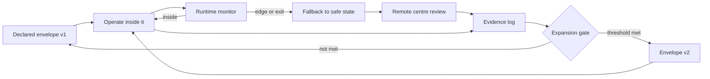

Mid-morning on a wide road south of the city, a row of cones pushes the traffic over and leaves the inside lanes empty in the heat. A white car with a sensor mast on its roof runs down the emptied stretch, slows, holds its line, runs again. Behind it the mouth of a tunnel is shut. The drivers crawling in the open lanes beside it are going nowhere fast, and that is the point of the exercise.

That was Emirates Road, opposite Al Maktoum International Airport, for six days at the end of October. Dubai's Roads and Transport Authority [closed three lanes of the E611 and the airport tunnel from 26 to 31 October 2026](https://www.thenationalnews.com/news/uae/2026/10/26/dubai-announces-lane-closures-on-emirates-road-from-monday-to-allow-for-self-driving-taxi-tests/), from 9am to 4pm each day, for autonomous vehicle trials. The National's report does not say which operator ran them. It does say that the authority's test lab at Dubai Silicon Oasis runs 248 traffic and weather scenarios, and that public-road testing already runs from Silicon Oasis to Al Qudra.

Read as news, a lane closure is a traffic notice. Read as engineering, it is the most honest artifact in the whole programme. It shows a design pattern that every team shipping machine learning into the physical world should copy, and that most enterprise teams shipping it into software skip: the operational design domain treated as a release contract.

## What is an operational design domain, in practice?

The term comes from automated driving. An operational design domain, or ODD, is the set of conditions a system is designed to operate in: which roads, which speeds, which hours, which weather, which lane markings, which kinds of junction. [ISO 34503:2023](https://www.iso.org/standard/78952.html) gives a taxonomy for writing one down. The concept is simple enough. What matters is what you hang off it.

Used as a pattern, the ODD has four parts.

First, a declared envelope. Written, versioned, specific enough that two engineers would agree whether a given street at a given hour is inside it.

Second, a runtime monitor. The system has to know, on its own, when it is approaching the edge of the envelope or has already left it. A geofence handles the easy case of location. Sandstorm visibility, a police officer waving traffic through a red light, or a lane that has been repainted overnight are the hard cases.

Third, a fallback. When the monitor fires, the system drops to a defined safe state, and a human somewhere can take responsibility. In a robotaxi that means pulling over and handing off to a remote centre.

Fourth, an expansion gate. The envelope grows only when evidence collected inside the current version clears a threshold someone set in advance.

The loop matters more than any single box. Every exit is data for the next version of the envelope. A team that only counts successful rides inside the envelope is measuring the easy half.

## How is Dubai running the loop?

Street by street, and in public. The sequence is easy to reconstruct. Baidu's Apollo Go began trials in August 2025 with 50 RT6 vehicles on designated roads. On 8 January 2026 Gulf News reported that the authority had issued [Dubai's first permit for fully driverless trials without a safety driver](https://gulfnews.com/uae/transport/dubai-opens-first-driverless-taxi-control-centre-first-permit-issued-1.500401882), and that Apollo Go had opened a 2,000-square-metre control centre at Dubai Science Park covering operations, simulation, maintenance and what the operator called rapid response. A day later the same paper, working from an RTA video presentation, described [Phase One as 65 locations: 17 in Zone One and 48 in Zone Two](https://gulfnews.com/amp/story/uae%2Ftransport%2Fdubai-rta-reveals-phase-1-rollout-of-driverless-robotaxis-across-65-locations-1.500403033).

Then commercial service, but narrow. When Uber switched on Apollo Go in its Dubai app on 20 August 2026, [coverage started with Jumeirah and Umm Suqeim](https://thenationalnews.com/future/technology/2026/08/20/uber-and-baidu-start-driverless-taxi-service-in-dubai), two residential coastal districts, with expansion promised. Uber's Sarfraz Maredia called it the first time the company's "multi-partner vision comes to life on public roads." The envelope at launch was a slice of the city with wide roads and predictable traffic. Emirates Road, a high-speed arterial next to an airport, is a different envelope altogether, and the authority is clearing lanes to collect evidence on it before anyone sells a ride there.

Down the coast, Abu Dhabi shows the pattern in a sharper form. WeRide's [release of 12 February 2026](https://ir.weride.ai/news-releases/news-release-details/weride-and-uber-begin-first-commercial-robotaxi-service-downtown) describes service across about 70 percent of the capital's core areas, up from roughly half, with the Integrated Transport Centre endorsing the expansion. The same release notes that WeRide began fully driverless commercial rides on Yas Island in November 2025, while the new downtown service runs with a vehicle specialist on board. One company, one city, one vehicle model, two envelopes with two different fallbacks. That is ODD-as-contract working as intended: the island earned its empty driver's seat, the downtown grid has not yet.

## Why should a bank or a hospital care about cones on Emirates Road?

Because enterprise ML is shipped almost entirely without the first, second and fourth parts of this pattern. Teams deploy a credit model, a claims triage agent or a document classifier, and the envelope is implicit: whatever the training data happened to contain. There is rarely a runtime monitor that knows when an input sits outside it. The fallback, if one exists, is a human reviewer drowning in a queue. Expansion happens when a business unit asks for it.

The translation is direct. The declared envelope is a written specification of the inputs the model was validated on: document types, languages, customer segments, value ranges, channels. The runtime monitor is an out-of-distribution check that runs on every request and tags it inside, edge or outside. The fallback is an abstain path with a named owner and a service level, sized for the abstention rate you measured in shadow mode. The expansion gate is a pre-registered threshold: the model takes on Arabic-language claims, or a new product line, when error and abstention on a shadowed sample clear a bar set before the shadowing began.

None of that requires new tooling. It requires writing down the map before you drive, and refusing to redraw it without evidence.

## What does the strongest objection get right?

Philip Koopman and William Widen make the case against leaning on this pattern too hard. Their paper [Redefining Safety for Autonomous Vehicles](https://arxiv.org/abs/2404.16768), revised in August 2024, argues that conventional safety definitions break down for driverless systems because they operate in an open world, must enforce their own operational limits, and sit inside an ad hoc system of systems with other road users. Read against Dubai, the point lands. An envelope declared as "Jumeirah, daytime" is still open-world inside its boundary. A delivery van double-parked on a residential street is inside the geofence and outside anything the designers enumerated.

They are right that the ODD does not make the world closed. Where I part company is the conclusion a reader might draw, that the envelope is therefore a weak tool. The second part of the pattern, the runtime monitor, is exactly the "self-enforcing operational limits" they name as the hard problem. The envelope does not solve open-world risk. It tells you where you have chosen to absorb it, and it gives the monitor something concrete to enforce. Without a declared envelope there is nothing to self-enforce against.

Even the loudest advocate of generalist driving has converged on the boundary. On Tesla's third-quarter call on 21 October 2026, AI software lead Ashok Elluswamy said the remaining requirement for unsupervised customer cars was [making sure they "can be part of the geofences and the fleet management"](https://evwire.com/p/tesla-tsla-q3-2026-earnings-call-full-transcript) Tesla already runs, and put the first ones "somewhere around Q2 next year."

## Where is the gate in Dubai?

This is my disagreement with how Dubai is running it. The envelope is visible. The cones are visible. The gate is not. Nothing I could find from the authority publishes what evidence moved the programme from 50 trial cars to commercial rides in Jumeirah, what disengagement or fallback rate a zone must show before it joins the map, or what the remote centre at Dubai Science Park handled per thousand rides. The operators publish fleet counts and permit firsts. Those describe the envelope's size and say nothing about its edges.

That matters because the destination is fixed and ambitious. The RTA's [Self-Driving Transport Strategy](https://www.rta.ae/links/sdt/Self-Driving-Transport-Strategy.pdf) aims to make 25 percent of total transportation in Dubai autonomous by 2030. A target of that kind invites someone, in 2028 or 2029, to widen the envelope faster than the evidence supports. A published gate is the only thing that makes that pressure visible. I would not treat the 2030 figure as meaningful until each ODD version and the threshold that admitted it are public, in a form an outside engineer can check. That is the same standard I would hold a bank's model inventory to, and Dubai has shown more discipline on the first half of the pattern than most banks.

## For the shift at Dubai Science Park

For whoever takes the morning shift in that control room: the map on your screen is the product. The car knows the lines on it and nothing beyond them. You are the one who knows what the map leaves out, the van on the kerb, the cones that went up overnight, the lane that was in the envelope yesterday and is not today. When a car asks you a question, the first one to answer is whether it is still inside the lines. If it is not, bring it home and write down where it crossed. Someone will use that note to draw the next version.

---

*Tarry Singh is the founder and CEO of [Real AI](https://realai.eu), an enterprise AI advisory and deployment firm working with global enterprises on production agent systems, model risk, and AI sovereignty strategy. He also leads [Earthscan](https://earthscan.io) for Energy AI startup, and is a founding contributor to the EU-funded HCAIM and PANORAIMA programmes for responsible AI education across European universities. He writes at [tarrysingh.com](https://tarrysingh.com).*
