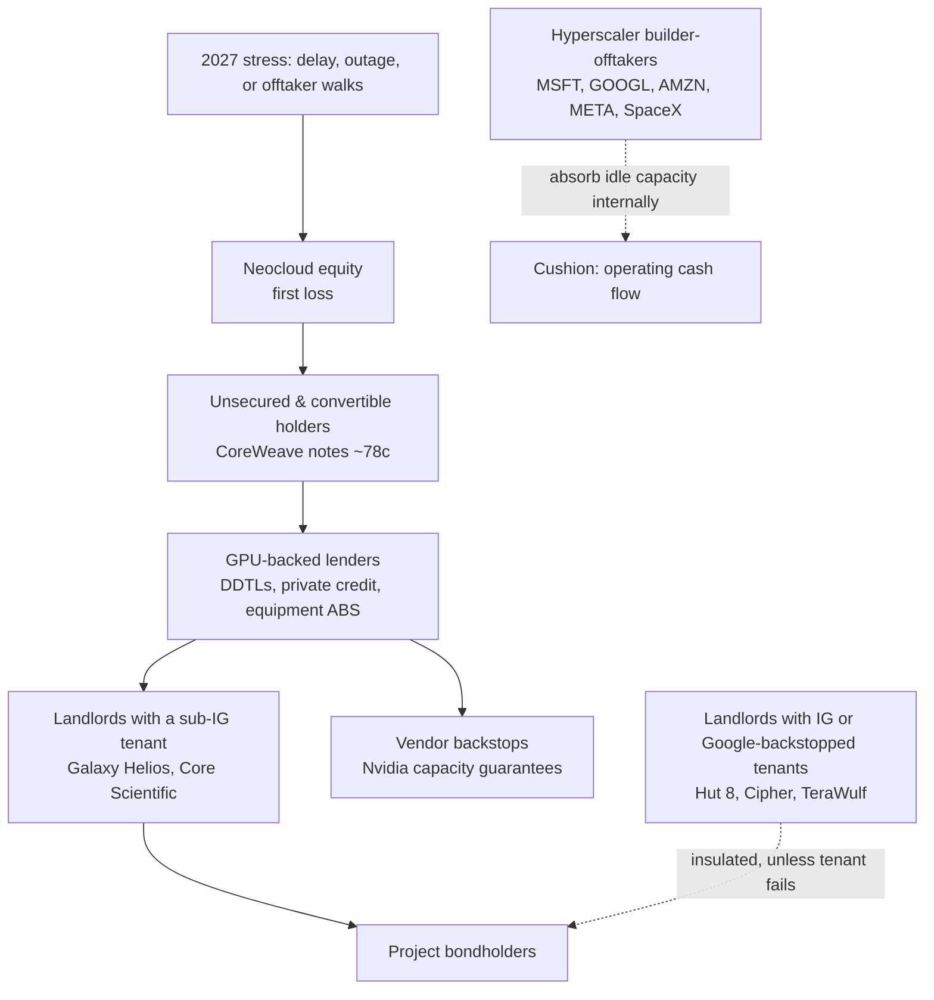

On Sunday, two of the loudest voices in technology finance agreed with each other on X. Chamath Palihapitiya, writing as someone with "a portfolio of energized land assets", said neoclouds are disorganised and poorly capitalised, that delays in the build pipeline will catch people off guard in 2027, and that a lot more compute will end up partially stranded or sitting in inventory than anyone currently forecasts. Elon Musk replied "Pretty much", added that debt markets have almost entirely shut off for any company without substantial revenue independent of AI data centres, and predicted "guppy-level death and consolidation" for the 200-plus neoclouds.

On the same weekend, an H200 rented for [$6.30 an hour on the Ornn index](https://data.ornn.com/), up 24 percent in a month. A B200 cost $9.70, up 21 percent. And CoreWeave's 2032 bonds, issued at 9.625 percent in June, were changing hands at [around 78 cents on the dollar](https://finance.yahoo.com/markets/stocks/articles/oracles-default-insurance-hits-record-122137367.html), a yield above 16 percent.

That is the puzzle this piece is about. The product is scarce and getting more expensive. The companies that sell it are being priced by the bond market as if a meaningful share of them will not survive. Both things are true at once, and the gap between them tells you exactly who loses money when 2027 arrives.

I have spent the last week pulling filings, offering memoranda, rating notes, grid-operator documents and the credit tape. The short version: Musk overstates the speed, Chamath is right about the mechanism, and the losses will not land where most people expect. They will land on whoever financed a short-lived asset with a mismatched clock, against a customer who can walk.

## Read the messengers before the message

Both men are talking their book. That does not make them wrong, but it tells you which parts of the argument to check hardest.

Chamath has said on the Moonshots podcast that he has assembled [nearly six gigawatts of power-related opportunities or assets](https://clclt.com/business-2/chamath-agi-energy-ai-investing-2026/). No company name or site list has been published. The one site on the public record is the roughly 2,000-acre Hassayampa Ranch tract west of Phoenix, bought by Arizona Land Consulting with his backing and pitched at [1.5 GW](https://www.datacenterdynamics.com/en/news/arizona-land-consulting-buys-land-for-potential-15gw-data-center/). Energised land is worth most when hyperscalers are slow, neoclouds are weak, and a fast, well-capitalised buyer needs megawatts now. His post describes precisely that world. Several outlets also report the original post was later [deleted](https://tradersunion.com/news/market-voices/show/3960487-palihapitiya-neoclouds-hyperscalers-commentary/), so treat the wording as reported rather than final.

Musk's reply needs more care, because it contains a factual claim. He wrote that SpaceX "closed $40B of debt for GPUs". The company's own [8-K, filed today](https://www.sec.gov/Archives/edgar/data/0001181412/000110465926118614/tm2628247d1_8k.htm), describes something narrower: a binding commitment letter for a GPU equipment finance lease, in which an Apollo-managed entity buys the GPU pods and leases them to SpaceX over tranches of roughly five years. The rate has not been fixed. Closing is expected before year-end, with the first schedules in the first half of 2027. Reuters reported the deal [aims to finalise by year-end](https://www.investing.com/news/stock-market-news/spacex-enters-40-billion-deal-with-apollo-for-ai-chip-financing-4972566); one market report has the junior tranche being [talked at around 8.3 percent](https://www.fxstreet.com/analysis/anthropics-public-s-1-could-land-as-soon-as-today-amid-musk-warning-about-neoclouds-202610261001). It is a large, real financing. It is not closed debt.

SpaceX is investment grade. Moody's, Fitch and S&P [rated it Baa1, BBB+ and BBB](https://www.spokesman.com/stories/2026/jun/18/spacex-gets-investment-grade-ratings-with-stable-o/) in June. But its debut bonds have [traded wider than the BBB index](https://247wallst.com/investing/2026/07/15/wall-street-is-ignoring-the-bond-markets-warning-spacex-is-junk/) since issue, closer to double-B spreads. Since the February all-stock acquisition of xAI, "SpaceX GPUs" means xAI compute in Memphis.

One more detail matters. In May, Anthropic agreed to rent [all of Colossus 1](https://finance.yahoo.com/news/anthropic-to-rent-all-ai-capacity-at-spacexs-colossus-data-center-180327774.html), over 220,000 Nvidia GPUs, from SpaceX. Musk is a landlord to one of the model companies Chamath says the hyperscalers are already turning away. When Chamath writes that every player will be underearning "except ONE (you can guess which one)", the obvious reading is the company Musk runs. Two investors with exposure to the same outcome are describing the same outcome.

So: the direction of their argument deserves serious attention. The specifics need checking.

## Who the neoclouds actually are

"Neocloud" has become a catch-all. Musk's 200-plus is, if anything, conservative. SemiAnalysis's ClusterMAX 3.0, published last month, [tracks 323 providers](https://newsletter.semianalysis.com/p/clustermax-30-the-industry-standard), up from 209 in its previous edition, and rates 77 of them. Only 19 earned a medal. American Compute counts [536 GPU cloud operators across 45 countries](https://www.amcompute.com/blog/state-of-the-neoclouds-2026), of which 147 are neoclouds in the strict sense.

That number hides five quite different businesses, and they carry very different risk.

1. **GPU owner-operators.** CoreWeave, Nebius, Lambda, Nscale, Crusoe, Firmus, Yotta. They buy the chips, borrow against them, and rent compute by the hour or on multi-year contracts. They carry the residual value of the silicon.
2. **Powered-shell landlords.** Mostly former bitcoin miners: Applied Digital, TeraWulf, Cipher, Core Scientific, Hut 8, Galaxy's Helios campus. They own land, power and buildings, and lease them for ten to twenty years. The tenant owns the GPUs.
3. **Hybrids.** IREN is the clearest case: it owns sites and power, and also buys GPUs for Microsoft under a five-year contract.
4. **Asset-light brokers.** Fluidstack sits between Anthropic and the landlords, with Google backstopping some of its lease obligations.
5. **Sovereign platforms.** Humain in Saudi Arabia, G42 and Core42 in the UAE. Their cost of capital is a policy choice, not a market price.

When people say "neoclouds will die", they almost always mean the first group. The second group has a completely different problem, which we will get to.

## Is the debt market actually shut?

Musk's strongest claim is that debt markets have "almost entirely shut off" for borrowers without non-AI revenue. The evidence says the market has repriced violently and become selective. It has not closed.

The stress is real and recent:

- **CoreWeave.** Its 9.75 percent 2031 notes hit a [record yield of about 15.8 percent](https://www.top1markets.com/news/neocloud-stocks-selloff-coreweave-nebius-iren-october-2026), and five-year credit default swaps traded above 1,000 basis points. About [$4 billion of its corporate debt](https://www.forbes.com/sites/giacomotognini/2026/10/16/why-debt-laden-neoclouds-could-become-a-trillion-dollar-wework-20/) trades below 80 cents. Its August GPU-backed loan priced [100 basis points wider](https://www.theenergymag.com/news/2026-08-11/coreweave-ai-2-6-billion-wider-spread) than a similar facility three months earlier.
- **Junk issuance.** Of roughly $80 billion of data-centre bonds issued this year, $37 billion is high yield, against $8.6 billion of $36 billion in 2025, according to figures [cited by Forbes](https://www.forbes.com/sites/giacomotognini/2026/10/16/why-debt-laden-neoclouds-could-become-a-trillion-dollar-wework-20/). Bonds backed by CoreWeave leases yield around 11 percent.
- **Project paper.** The FT reported in mid-October that Meta's Hyperion SPV bonds had slipped to [just under 92 cents](https://dealroom.co/news/other-1ni755j-investors-dump-data-centre-bonds-as-ai-borrowers-face-darwin-moment/), down from above par in July, when an Oracle-linked Michigan campus bond was already trading at 87.
- **Banks struggling to sell down.** JPMorgan and MUFG took more than six months to place the $38 billion Vantage construction loan for Oracle's campuses, some of it at a discount.
- **Equity windows.** Firmus pulled its ASX listing on 9 October. Nscale's IPO is under pressure after Microsoft walked away from its UK Loughton site.
- **Borrowers saying it out loud.** Nebius's chief executive, speaking at Nvidia's GTC event in Berlin, [acknowledged](https://stocktwits.com/news-articles/markets/equity/nebius-ceo-admits-neocloud-financing-has-tightened-says-company-has-enough-to-build-its-gigawatt/cZUd80tRByG) that asset-backed financing and debt markets had tightened sharply for the sector.
- **Private credit liquidity.** Blue Owl's evergreen funds received Q3 redemption requests of [39 percent and 16.8 percent](https://www.benzinga.com/markets/equities/26/10/62152913/blue-owl-stock-at-risk-as-private-credit-giant-caps-withdrawals-amid-surging-outflows) and capped withdrawals at 5 percent.

The immediate trigger was macro, not AI-specific: the hot CPI print on 14 October and a market that now prices a Federal Reserve hike. Long-duration, high-coupon, single-customer credit is the first thing investors sell when rates go the wrong way.

Against "shut off": Lambda closed a [$926 million term loan at SOFR plus 300](https://mlq.ai/news/lambda-adds-1-billion-private-debt-deal-as-microsoft-gpu-demand-drives-neocloud-borrowing/) in late August. Nebius secured a $3.5 billion Citi facility maturing next October. GPU collateral is entering equipment ABS. And as of this month, no neocloud has [defaulted on a GPU-backed loan](https://www.amcompute.com/gpu-risk/defaults). The bankruptcy on record this autumn is Character.AI, a buyer of compute, not a seller.

My read: Musk is right on the direction and early on the degree. What has closed is cheap, unsecured, long-dated money for borrowers whose only story is AI. What remains open is secured money tied to an investment-grade counterparty, at a price. That distinction is the whole game.

## Demand is not the problem, yet

If compute were really piling up unsold, rental prices would be falling. They are rising. One-year H100 contracts went from about [$1.70 an hour in October 2025 to $2.35 by March](https://newsletter.semianalysis.com/p/the-great-gpu-shortage-rental-capacity), and spot indices have kept climbing since.

The buyers are saying the same thing. Meta told analysts in July that outside parties have offered to buy its compute at multiples of what it paid. Amazon's finance chief said 2027 AWS capacity is largely reserved. And Anthropic's S-1, made public today, says it has [sought quantities of compute](https://www.sec.gov/Archives/edgar/data/0002130357/000162828026067168/anthropicpbc-sx1.htm) from cloud providers in excess of what those partners were willing to provide, and warns it may be unable to secure adequate alternatives. That is not quite the rumour Chamath repeated, that a hyperscaler told Anthropic it had no compute at all. But it is the same tension in the company's own words: the hyperscalers have their own models to feed, and they ration.

So where does "stranded compute" come from in a world of shortage? Read Chamath's post closely and the answer is in his first sentence about 2027: delays in the existing pipeline. Stranding in 2027 is not mostly about nobody wanting GPUs. It is about GPUs that cannot be switched on, or cannot be switched on by the date in the contract.

Jay Goldberg at Seaport [expects only about 30 GW](https://finance.yahoo.com/technology/ai/articles/nvidia-analyst-warns-45-ai-164708977.html) of the 55 GW announced for 2027 to actually be built, citing electricians, turbines and grid connections. SemiAnalysis is more constructive at [around 50 GW globally](https://www.theneuron.ai/news/semianalysis-data-center-forecast-2027/), but it counts 24 GW in advanced construction, not 50. The gap between those numbers is chips bought, or ordered, for buildings that will be late.

A GPU in a warehouse earns nothing and depreciates anyway. A GPU in a half-finished hall with no grid connection is the same thing with a construction loan attached.

## Three clocks that do not agree

Here is the structural problem, and it is visible in CoreWeave's own documents.

The company depreciates its GPUs over [six years, straight line](https://capefearadvisors.substack.com/p/the-second-contract). Its latest GPU-backed facility advances 70 percent of cost and runs just over five years. And CoreWeave has described its average customer contract as roughly three years.

So the debt outlives the contract, and the depreciation schedule outlives the debt. The lender is underwriting not the first contract, which is signed, but the *second* one: what a three-year-old Hopper or Blackwell rents for in 2028 or 2029, after Rubin has shipped. Today's rising rental prices say nothing about that number. They describe a shortage of the current generation, not the value of the previous one.

This is where the ghosts of earlier cycles come in. Anyone who lived through the 2001 unwind remembers that the fibre was never the problem. Demand for bandwidth kept growing for a decade. What failed was the financing: carriers that funded thirty-year assets with five-year paper, priced on the assumption that the price per unit would hold. Global Crossing's cable is still carrying traffic. Its shareholders were wiped out.

GPUs invert that problem. The asset life is short and the financing is long relative to the contract. But the failure mode rhymes: the gap between what you owe and what the second customer will pay.

## The final boss: liquidated damages

Chamath called the liquidated-damages clauses in neocloud offtake contracts the final boss battle. This is the part of his post that is best supported by the documents, because the clauses are sitting in SEC filings.

Nebius's agreement with Microsoft, filed as [an exhibit to its annual report](https://www.sec.gov/Archives/edgar/data/1513845/000110465926052948/nbis-20251231xex4d4.htm), sets liquidated damages as a percentage of the daily bill for each day a delivery is late. After a grace period, Microsoft may terminate. Missing a revised date counts as termination, and Nebius refunds the upfront payment, net of damages already paid. Microsoft can also terminate if control passes to Amazon or Google without its consent, which matters in a consolidation year.

IREN's [$9.7 billion Microsoft contract](https://iren.gcs-web.com/static-files/87a13320-156c-4f88-8589-dee2d10faa81) has the same architecture: service-level commitments, delay credits, and termination if delivery dates are missed after a cure period. Microsoft prepays 20 percent of each tranche, credited against fees later in the term.

Nscale's registration statement, as [summarised by Daloopa](https://daloopa.com/blog/analyst-pov/scout-built-the-nscl-model-i-read-the-fine-print), is harsher. Microsoft is credited 100 percent of the daily bill for every day of delay. If a service will be more than 60 days late, Microsoft can terminate or reset; missing the reset ends it. Anthropic can end any late tranche without liability and can exit if uptime falls below set thresholds.

Read that last clause twice. A neocloud can sign a $44.6 billion contract, borrow against it, buy the GPUs, and lose the customer because a substation was late. The contract value on the press release is a ceiling. The floor is whatever survives the delivery schedule.

It has already happened in public:

- **Abilene, March 2026.** Oracle and OpenAI [dropped the expansion](https://www.datacenterdynamics.com/en/news/oracleopenai-drop-plans-to-expand-flagship-abilene-stargate-site-meta-in-talks-to-pick-up-crusoe-capacity-with-nvidias-help/) of the flagship Stargate site. DCD cited financing challenges and OpenAI's shifting demand forecasts, and reported that a multi-day winter outage in the liquid cooling had strained relations between OpenAI and Crusoe. Nvidia reportedly paid Crusoe a $150 million deposit to secure the site while talks with Meta continue.
- **Loughton, October 2026.** Microsoft [walked away](https://www.techtarget.com/it-infrastructure/news/366652477/Microsofts-Nscale-exit-exposes-103B-AI-contract-pipeline-risk) from Nscale's Essex site, 23,040 GB300 GPUs, after the grid operator said full power might not arrive until the 2030s.
- **Denton, late 2025.** A third-party developer ran late on CoreWeave's Texas site and CoreWeave cut its 2025 guidance. The customer [agreed to move contract dates](https://www.datacenterdynamics.com/en/news/coreweave-deploys-16000-gpus-at-delayed-data-center-in-denton-texas/) rather than cancel.

Only one of these involved demand at all, and even there an outage was part of the story. The others were physical: a grid connection and a construction schedule. Chamath's point that uptime and maintenance are the real moat is exactly right. Running a 100 MW liquid-cooled hall at five nines is an industrial discipline, closer to running a refinery than a software company, and most of the 323 providers have never done it at scale.

## Power, Texas and the queue

The physical bottleneck is the grid, and Texas is where it is most visible this autumn.

ERCOT's large-load queue reached roughly [474 GW](https://www.utilitydive.com/news/texas-hits-pause-data-center-interconnections/827046/) by August, about 90 percent of it data centres and more than five times the system's record peak. On 3 August, Governor Abbott ordered the Public Utility Commission and ERCOT to [audit every data centre](https://www.gibsondunn.com/what-governor-abbotts-data-center-audit-directive-means-for-ercot-and-the-batch-zero-study-process/) in the interconnection process, covering water, incentives, self-supply, ownership and community impact. ERCOT paused its Batch Zero study. BNEF estimated [49.8 GW of data-centre load](https://www.powermag.com/texas-audit-could-delay-49-8-gw-of-data-center-load-cost-projects-up-to-15-billion-bnef-warns/) could be delayed. ERCOT now aims to finish the audit of about 300 projects by [10 December](https://www.utilitydive.com/news/ercot-texas-puc-data-center-audit/828472/), and has said its study will not be done by the April 2027 date. On 21 September, Abbott went further and told the state environmental regulator to stop issuing data-centre permits until the audits finish, which reaches off-grid, behind-the-meter projects too.

Meanwhile, the PUCT's rule implementing SB 6 requires [$50,000 per MW](https://www.whitecase.com/insight-alert/puct-sets-financial-commitments-data-center-interconnection-governor-pauses-permit) of security before a study. A customer that withdraws after capacity is allocated forfeits part of it, and one that fails to energise within 24 months of schedule has it applied to what it owes. Dominion in Virginia now requires [$1.5 million per MW](https://www.forbes.com/sites/daraabasiita/2026/06/09/virginia-now-makes-data-centers-post-15-million-a-megawatt/) of collateral and, from January 2027, minimum payments of 85 percent of transmission and distribution capacity and 60 percent of generation capacity over 14-year contracts. AEP Ohio's similar tariff [shrank its pipeline](https://www.datacenterdynamics.com/en/news/aep-ohio-slashes-data-center-pipeline-by-more-than-half-report/) from more than 30 GW to 13 GW.

This is Chamath's third point, made concrete: utilities are flushing out squatters by demanding capital earlier. It is also his fourth. A $50,000 or $1.5 million per MW deposit is trivial for Microsoft and a real burden for a neocloud with a few hundred million dollars of revenue and a 400 MW pipeline. When the builder and the offtaker are the same investment-grade balance sheet, the deposit is a rounding error and the utility knows the load is real.

The equipment queue tells the same story. GE Vernova's gas-turbine backlog and reservations reached [116 GW](https://www.turbomachinerymag.com/view/ge-vernova-gas-turbine-backlog-hits-116-gw-as-power-orders-more-than-double) at the end of the second quarter, against output of about 20 GW a year. Siemens Energy quotes [three years or more](https://www.utilitydive.com/news/siemens-gas-turbine-backlog-nears-70-gw-as-company-expands-manufacturing/827390/). Large power transformers average around 128 weeks. A developer who orders today is building for 2029.

Two of Chamath's Texas claims I could not substantiate. The legal risk around mineral rights is real: Texas treats the mineral estate as dominant, and courts have applied the accommodation doctrine to surface projects like the solar farm in [Lyle v. Midway Solar](https://davisgraham.com/news-events/texas-court-addresses-conflict-between-solar-and-mineral-development/). Practitioners now advise data-centre developers to do title work [with the rigour of an oil company](https://azbigmedia.com/real-estate/lessons-from-shale-guide-data-center-land-rush/). But I found no recorded dispute or delay at a data-centre site caused by it, and no evidence that East Texas is unbuildable for legal reasons. These may be things he sees in his own deal flow. They are not yet on the public record.

Local opposition is on the record. Data Center Watch counted at least 75 projects worth about $130 billion blocked or delayed in Q1 2026, and secondary reporting puts the first-half total near [120 projects](https://www.trendingtopics.eu/us-data-center-opposition-q2-2026/), with 843 local opposition groups. According to a [state policy tracker](https://dcmap.us/insights/policy/), New York, Illinois, Ohio, Nebraska, Pennsylvania and Texas all paused some form of data-centre approval this year. Chamath's fifth point stands.

## The balance-sheet map

Now to the question that matters for anyone with capital in this: who actually holds the exposure, and how much cushion do they have?

| Entity | What is at stake | How it is funded | Weak point | Cushion |
|---|---|---|---|---|
| CoreWeave | $35.1B debt, $16.3B operating leases, $104B backlog | DDTLs, 9–10% notes, converts, Nvidia equity | ~$6.2B debt due within 12 months; 3-year contracts against 5-year debt | Thin; CDS above 1,000bp |
| Nscale | $103.4B contract value, 55 MW live | Converts, Nvidia support | 85% from two customers; strict delay clauses | Thin; IPO not done |
| Nebius | $37.5B RPO; $20–25B 2026 capex | Converts at 0.5–4.5%, equity, $9B+ prepayments | Three customers ~59% of revenue | Moderate |
| IREN | ~$7.6B debt; $9.7B Microsoft contract | Investment-grade GPU loan at ~6%, converts | Owns GPU residual | Moderate |
| Galaxy Helios | $3.5B notes at 9.875% | Project bonds | 100% CoreWeave tenant | Inherits CoreWeave credit |
| Hut 8 | $7.5B IG project notes | Amortising, non-recourse | Construction to 2027 | Strong; IG or backstopped tenants |
| Oracle | $260B uncommenced leases; $664B RPO, ~half OpenAI | Bonds, $20B ATM equity | Negative FCF; BBB-; record CDS (288bp) | Thin for an IG name |
| OpenAI | $600–856B compute commitments to 2030 | Equity ($122B round) | ~$36B 2026 revenue | Equity only |
| SoftBank | >$60B into OpenAI and Stargate | Bridge loans, margin loans | $40B bridge due March 2027; CDS ~430bp | Thin |
| Nvidia | $105B guaranty cap on one Ohio project; ~$55B in private and equity-method investments | Free cash flow | Receivables up to ~60 days; correlated risk | Very large |
| Meta | ~$420B leases and commitments; residual value guarantees on Hyperion and El Paso | Bonds, SPVs | Q2 free cash flow under $1B | Ad business |
| Microsoft | $329B uncommenced leases; $60B+ neocloud contracts | Operating cash flow | OpenAI ~32% of RPO (estimate) | Very large; positive FCF |

Sources for the table: company filings and releases for [CoreWeave](https://investors.coreweave.com/news/news-details/2026/CoreWeave-Reports-Strong-Second-Quarter-2026-Results/default.aspx), [Nebius](https://assets.nebius.com/assets/4462517b-ce83-41f2-96ed-f2ac1bc06a05/SHLQ226%20(1).pdf-0), [IREN](https://iren.gcs-web.com/static-files/1cb9f4da-d4c7-4510-8bda-e475022b59f5), Galaxy's [notes](https://www.sec.gov/Archives/edgar/data/1859392/000185939226000074/exhibit991-pressreleasepri.htm) and [Q2 release](https://www.sec.gov/Archives/edgar/data/1859392/000185939226000084/glxy-20260630xpressrelease.htm), [Hut 8](https://www.prnewswire.com/news-releases/hut-8-reports-second-quarter-2026-results-302841830.html) and [Nvidia](https://www.sec.gov/Archives/edgar/data/0001045810/000104581026000075/nvda-20260726.htm); Nebius [customer concentration](https://247wallst.com/investing/2026/10/01/just-how-exposed-is-nebius-at-235/), [capex guidance](https://finance.yahoo.com/technology/ai/articles/nebius-q2-revenue-jumps-454-140044127.html) and [convertibles](https://www.datacenterdynamics.com/en/news/nebius-secures-575bn-in-senior-notes-offering/); [Nscale](https://cryptobriefing.com/nscale-103-billion-data-center-contracts-ipo/) via press coverage of its S-1; [Oracle](https://erp.today/oracle-q1-fy27-results-664b-backlog-ai-contracts/) and its [lease disclosure](https://r40.io/blog/orcl-260bn-of-leases-off-the-balance-sheet/); [OpenAI](https://thenextweb.com/news/openai-856bn-compute-vs-600bn-reset-burn-improved) via FT reporting; [SoftBank](https://startupfortune.com/softbank-pushes-for-a-full-10-billion-loan-against-its-openai-stake/) and its [CDS](https://theedgemalaysia.com/node/822480); Microsoft's [lease disclosure](https://btw.media/en/microsoft-329-1bn-uncommenced-datacentre-leases) and [neocloud contracts](https://introl.com/blog/microsoft-60-billion-neocloud-spending-2025); hyperscaler [lease and commitment totals](https://mlq.ai/news/inside-big-techs-167-trillion-of-leases-and-purchase-commitments/). Oracle's total debt is reported anywhere from $118 billion to $167 billion depending on what is counted; I have left it out of the table rather than pick one.

A few things jump out.

**CoreWeave is the bellwether, not the weakest link.** It carries the largest absolute debt, about $51 billion including leases, against Q2 adjusted operating income of $128 million. But its backlog has diversified: Microsoft was 67 percent of 2025 revenue, yet S&P says the largest customer is now [about 35 percent of backlog](https://www.investing.com/news/stock-market-news/coreweave-outlook-revised-to-positive-by-sp-b-rating-affirmed-93CH-4606449), with Meta committing up to $21 billion more. Nvidia holds equity and has agreed to buy unused capacity through 2032. Its biggest facilities are matched to contracts. The risk is the near-term maturity wall and the second-contract pricing on Hopper, not an empty data centre.

**Nscale is the purest expression of the risk.** It has $103 billion of contract value on 55 MW of live capacity, a customer that has already walked from one site, delay clauses that credit the full daily bill, and an Anthropic contract that, per its own filing, was not yet financed. If the IPO prices, it has a chance. If it does not, the contract value is mostly theoretical.

**The landlords split cleanly in two.** Hut 8's River Bend campus is leased to Fluidstack for 15 years with Google backstopping the lease, financed with [BBB- rated amortising notes](https://theenergymag.com/news/2026-04-27/hut-fluidstack-ai-louisiana) at 6.2 percent. Galaxy's Helios Phase II is leased entirely to CoreWeave and financed at 9.875 percent. Same business model, nearly four points of difference in coupon, because the bond market prices the tenant, not the building. Octus puts the spread gap at about [389 basis points versus 226](https://octus.com/resources/articles/sector-insights-tech-hardware-ai-infrastructure-quarterly-q126/) for non-IG versus IG tenants, across $125 billion of non-IG AI infrastructure debt.

**Oracle is the largest investment-grade issuer whose balance sheet now depends on a model company.** It has $260 billion of data-centre leases that start between FY27 and FY29 and run 15 to 19 years, negative free cash flow, roughly half of its $664 billion backlog from OpenAI, and an [S&P rating of BBB-](https://mlq.ai/news/sp-downgrades-oracle-to-bbb-one-notch-above-junk-citing-openai-concentration-risk/), one notch above junk. Its five-year CDS hit a [record 288 basis points](https://finance.yahoo.com/markets/stocks/articles/oracles-default-insurance-hits-record-122137367.html) on 15 October. If 2027 strands capacity, Oracle cannot hand back a 19-year lease.

**The model companies are equity-funded, so their risk lands on shareholders and vendors.** OpenAI's compute commitments run to [$600 to $856 billion](https://thenextweb.com/news/openai-856bn-compute-vs-600bn-reset-burn-improved) through 2030 against about $36 billion of expected 2026 revenue. Anthropic's S-1 shows H1 2026 revenue of $16.3 billion, a net loss of $80.7 billion that reports attribute mostly to non-cash fair-value items, and multi-hundred-billion-dollar cloud commitments; reports on the drafts put the non-cancelable portion near $450 billion. When an equity-funded customer misses, the loss travels to its investors and to the RPO of the vendors that booked it: Oracle, Microsoft, CoreWeave, Google, Amazon.

**Nvidia sits at the centre of the web.** Its [latest 10-Q](https://www.sec.gov/Archives/edgar/data/0001045810/000104581026000075/nvda-20260726.htm) shows a residual value guaranty capped at $105 billion on a single 4.25 GW Ohio project, with the tenant's name redacted, alongside large supply and capacity commitments. It holds equity in OpenAI, CoreWeave and Nscale, is an LP in the xAI GPU vehicles it sells chips into, backstops capacity at CoreWeave, and reportedly at Yotta and others. Receivables have stretched to roughly 60 days of sales. The cushion is enormous in absolute terms, but the exposure is correlated: if customers default, they do it exactly when demand for new chips is softening.

**Private credit's problem is liquidity, not losses.** Investors in Meta's Hyperion bonds have a residual value guarantee from Meta behind them. Investors in Oracle-linked and xAI-linked paper have less. The near-term danger is the mismatch between retail evergreen funds that promise quarterly liquidity and fifteen-year project loans, which is precisely what Blue Owl's gates are signalling.

**The hyperscalers absorb, they do not break.** Alphabet posted its first negative free-cash-flow quarter since 2004 in Q2, and Amazon's trailing free cash flow turned negative. Meta's was barely positive. But each has its own workloads to fill idle capacity, and each can decline to renew a neocloud contract. That optionality is the point: the neocloud contract is, functionally, the hyperscaler's overflow valve. When it is not needed, the neocloud carries the cost.

## China and the rest of the world

Outside the US, the picture splits by who holds the risk.

**China has two problems at once.** It has too much low-end, government-promoted capacity, much of it in the western hubs of the East Data West Computing programme. Chinese outlets estimated in 2025 that up to [80 percent of newly built compute was unused](https://www.technologyreview.com/2025/03/26/1113802/china-ai-data-centers-unused/), and SMIC's co-chief executive warned in February that what the facilities would do [had not been fully thought through](https://www.tomshardware.com/tech-industry/artificial-intelligence/chinas-top-chipmaker-warns-that-rushed-ai-data-center-capacity-could-remain-idle-smic-chief-says-utilizing-ballooning-capacity-has-not-been-fully-thought-through). At the same time, high-end compute is scarce: H100 rentals rose [20 to 30 percent](https://www.trendforce.com/news/2026/04/17/news-nvidia-h100-rentals-in-china-reportedly-up-20-30-as-token-demand-surges-h-series-also-rises/) from October 2025, and Alibaba and Tencent raised AI compute prices in the spring. Nvidia's H200 shipments to China, approved by Washington in January, were blocked by Beijing's customs for months and are now arriving in small, state-approved batches.

The financing has quietly shifted. Rhodium Group found that combined free cash flow at Alibaba, Tencent and Baidu went from 170 billion yuan in 2025 to [minus 16 billion yuan in the first half of 2026](https://rhg.com/research/examining-chinas-ai-financing/). Financial leases were involved in 54 percent of computing-centre projects added in the first half, and the bankruptcy of Sichuan Binji Technology caused losses at 15 licensed leasing companies. There is no official utilisation statistic, so every Chinese idle-capacity figure should be read as an estimate. But the pattern is clear: stranded low-end capital sits with local governments, small leasing operators and the lessors behind them, not with the large platforms.

**The Gulf's risk is now physical and geopolitical.** Saudi Arabia's Humain has gigawatt-scale targets and expanded its Nvidia deal last week. The UAE's Stargate campus enclosed its first two buildings in August. But one tracker found [no confirmed energised megawatts](https://vision2030.ai/analysis/humain-data-centers-riyadh-dammam-status/) across 13 announced Saudi and Emirati projects. G42's licence-free access to US chips is reported to run only [until around April 2027](https://thenextweb.com/news/g42-us-ownership-chip-access-export-control-endgame). And AWS has said it could not restore data held only in its Bahrain region after Iranian strikes earlier this year, in a [September Health Dashboard update](https://dealroom.co/news/159947-gone-for-good-aws-writes-off-its-entire-bahrain-cloud-region-after-irani/). Sovereign funds hold this risk, which means it will not show up in credit spreads until it shows up in budgets.

**Europe is under-built, not over-built.** OpenAI [paused Stargate UK](https://thenextweb.com/news/openai-pauses-stargate-uk-energy-costs-regulation) in April over power prices and grid waits of three to eight years. Fluidstack [dropped its French sites](https://www.datacenterdynamics.com/en/news/fluidstack-drops-projects-in-france-to-focus-on-us-report/) to focus on the US. Amsterdam still bans new hyperscale builds, and Ireland now requires large new loads to bring their own dispatchable generation. The stranding mechanism in Europe is counterparty concentration at a few neoclouds, Nscale above all, not idle halls.

**India, Korea and Australia show the gap between announcements and contracts.** Yotta has reportedly ordered 80,000 GPUs worth about $12 billion against revenue of roughly [$108 million](https://catchthebrief.com/articles/2026-09-29-nvidia-bankrolls-yotta-s-12-billion-gpu-order-spree.html), supported by an Nvidia agreement to rent unused capacity. In Australia, Firmus and CDC [ended Project Southgate](https://www.lightreading.com/data-centers/firmus-cdc-end-planned-51b-australian-ai-buildout) after 42 MW of a planned 1.6 GW. Korea's SK Hyper talks about $350 billion with a seed commitment of under a billion dollars. Where Nvidia is the backstop, Nvidia is the risk-holder.

## Who loses money

Pull it together and the answer to "where will most of them lose money" is specific.

The neoclouds that lose money in 2027 will share four features. They own the GPUs. They financed them with debt that runs longer than the customer contract. Their anchor customer is either unrated or able to walk on delay or uptime. And a material share of their contracted capacity is not yet built. Score the field on those four and you get a rough ranking of exposure:

1. **Single-customer GPU owners with unbuilt capacity.** Nscale first, then Firmus and Yotta. Contract values in the tens of billions sit on tens of megawatts of live power.
2. **CoreWeave's equity and unsecured creditors.** The business may well survive; the question is at what price the near-term maturities refinance and what Hopper rents for on the second contract. The secured, IG-tenant facilities are better protected than the 9 to 10 percent notes.
3. **Private GPU owners on short-tenor debt.** Lambda's separate $1 billion private deal in August was reported as short-dated. Short-dated money is what disappears first in a turn.
4. **Landlords whose only tenant is a sub-investment-grade neocloud.** Galaxy Helios and the CoreWeave share of Core Scientific inherit CoreWeave's credit at near-10 percent coupons.
5. **Oracle and SoftBank.** Not neoclouds, but the two investment-grade-adjacent balance sheets with the most concentrated exposure to a single model company.
6. **Retail private-credit vehicles** that promised liquidity against fifteen-year project paper.

The winners are just as specific. The investment-grade builder-offtakers, Microsoft, Alphabet, Amazon, Meta, and now SpaceX, can post utility deposits without blinking, fill idle halls with their own workloads, and buy distressed capacity in 2027 at a discount. Powered-shell landlords with long leases to investment-grade or Google-backstopped tenants, financed with amortising investment-grade debt, are structurally insulated even if their shares trade with the sector. Hut 8, Cipher and TeraWulf are the clearest cases. And Nvidia wins on volume for as long as the build continues, while quietly accumulating the tail risk through its guarantees.

Chamath's line that 2027 will clear out bad bets and consolidate a few players is, on the evidence, the most likely outcome. Gartner already expects [more than 80 percent of neoclouds](https://www.forbes.com/sites/giacomotognini/2026/10/16/why-debt-laden-neoclouds-could-become-a-trillion-dollar-wework-20/) could fail or be acquired by 2030. Where I part company with both men is timing and cause. This is not a demand bust. Demand is the one thing in this market that has not disappointed. It is a credit-and-construction squeeze: rates moved against long-dated, high-coupon, single-customer paper at exactly the moment that grids, turbines and governors started slowing delivery dates, and the contracts were written so that late delivery is the customer's free option to leave.

## What to watch, in order

- **28 to 30 October.** Microsoft, Alphabet, Meta and Amazon report Q3. Watch 2027 capex guidance and any language about third-party capacity. A hyperscaler that says it will "prioritise internal workloads" is telling neoclouds their renewal odds.
- **16 November.** PJM and its transmission owners respond to FERC's [show-cause order](https://www.pjm.com/-/media/DotCom/documents/ferc/orders/2026/20260921-el26-67-001.pdf) on large-load interconnection.
- **10 December.** ERCOT's target date to finish the Texas data-centre audit.
- **Year-end.** Pricing on the SpaceX–Apollo GPU lease. Where the rate lands is the market's real verdict on investment-grade AI credit.
- **2027.** CoreWeave refinancing roughly $6.2 billion of debt classed as current; SoftBank's $40 billion bridge on 25 March; G42's chip-access window around April; first deliveries at Hut 8's River Bend and Beacon Point; and whether Nscale prices its IPO at all.

## $6.2 billion

That is the recourse debt CoreWeave classed as current at the end of June, due within twelve months, against a rental market that has never been tighter. The GPUs are not the problem. The calendar is.

---

*Tarry Singh is the founder and CEO of [Real AI](https://realai.eu), an enterprise AI advisory and deployment firm working with global enterprises on production agent systems, model risk, and AI sovereignty strategy. He also leads [Earthscan](https://earthscan.io) for Energy AI, and is a founding contributor to the EU-funded HCAIM and PANORAIMA programmes for responsible AI education across European universities. He writes at [tarrysingh.com](https://tarrysingh.com).*
