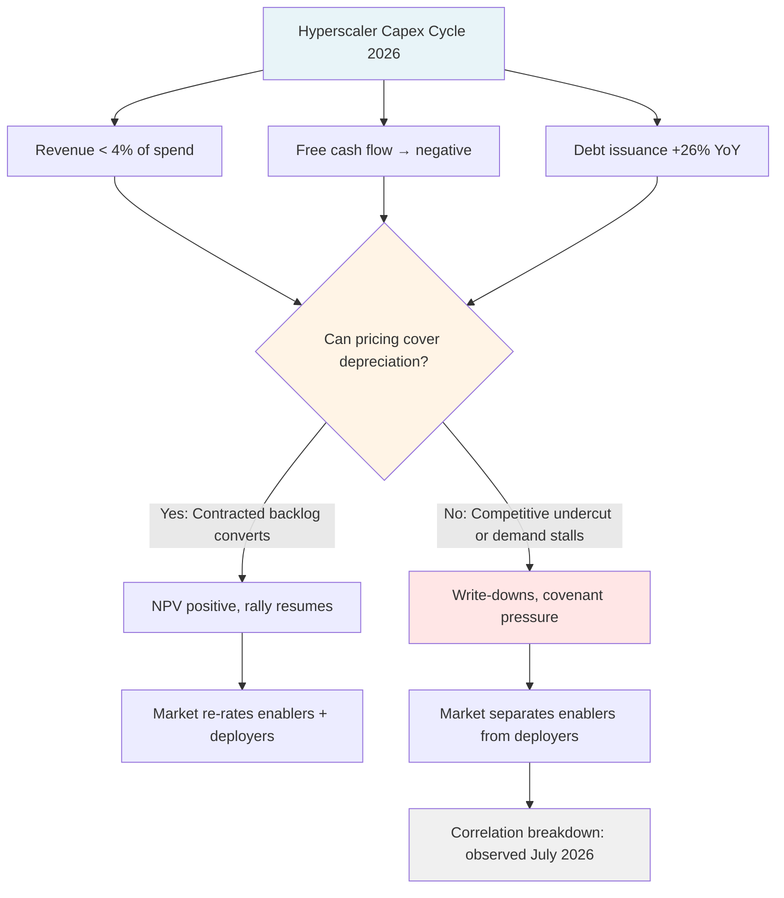

On 22 July 2026, Alphabet raised its full-year capex guidance to $195 billion–$205 billion

,

beat on every headline metric, and watched its stock fall as much as 7 per cent

.

The company's Q2 free cash flow turned negative at $5.9 billion—a first for the quarter

—and for the first time since the LLM cycle began, spending more was punished rather than celebrated.

That inversion is the story.

Microsoft, Alphabet, Amazon, Meta, and Oracle now collectively plan $660 billion–$690 billion in infrastructure capex for 2026

,

nearly six times their 2022 spending when ChatGPT launched

.

Roughly 75 per cent of that—around $450 billion—is directly tied to AI infrastructure

: GPUs, custom silicon, data centres, power, cooling. The scale has no precedent.

It approaches the total cost of building the U.S. railroad network, five times the interstate highway system, roughly ten times the Apollo programme

. But

Amazon, Meta, and Microsoft all fell as well, underscoring increased scrutiny of infrastructure investments that are resulting in dwindling cash piles with uncertain returns

.

If I were on one of these boards, I would demand a defensible NPV model before the next raise. Here is why.

## The arithmetic is starting to hurt

Current AI services generate approximately $25 billion in direct revenue across the major cloud providers, representing roughly 4 per cent of what is being spent on infrastructure

. That is not a rounding error—that is a 25:1 ratio of spend to revenue. Even with aggressive assumptions about margin, utilisation, and forward contracts, the payback timeline extends into mid-decade at best.

The major hyperscalers are now spending approximately 94 per cent of their operating cash flow on capital expenditures

.

Barclays analysts now see a drop of almost 90 per cent in Meta's free cash flow and are modelling negative FCF for 2027 and 2028—"somewhat shocking to us but likely what we eventually see for all companies in the AI infrastructure arms race"

.

Alphabet transformed from a high-margin money-printing machine to a company that is now seeing more cash leave the business than enter it

.

Free cash flow negative in a growth cycle is not automatically disqualifying—AWS spent years in the red. But AWS had visible, contracted cloud revenue from day one.

The combined backlog of contracted revenue across key hyperscalers has reached approximately $1.7 trillion

, which sounds encouraging until you parse the footnotes. Much of that backlog is contingent on supply delivery, model performance, and pricing that the vendors have not locked.

Hyperscalers carry $1.65 trillion in off-balance-sheet AI obligations

—commitments that do not appear in the depreciation schedule but will constrain capital allocation for years.

## Debt is replacing conviction

Hyperscalers are increasingly leaning on debt markets to bridge the gap between rapidly rising AI capex budgets and internal free cash flow; aggregate capex, after buybacks and dividends, is now above projected cash flows, thereby necessitating external funding

.

Alphabet raised roughly $70 billion in combined equity and debt, suspended its buyback programme, and doubled long-term debt to $98.2 billion

.

Amazon raised $25 billion in debt to fund its AI buildout

.

In the first half of 2026, debt-funded hyperscaler capex contributed to a 26 per cent year-over-year spike in U.S. corporate bond issuance

, according to Fitch Ratings.

Fitch's 23 July note warns that "the pipeline of planned debt and equity issuances in 2H26 will test market capacity to absorb new supply while equity valuations remain elevated and reliant on optimistic AI return assumptions"

.

Fitch states: "The U.S. credit outlook is increasingly levered to AI investment confidence"

.

That is market language for *if the AI thesis breaks, the bond market goes with it*. When companies historically issued debt to fund capex of this magnitude, they were regulated utilities with known demand curves or commodity producers with visible futures prices.

All the hyperscalers report that their markets are supply-constrained, rather than demand-constrained

—but supply constraints in an unproven end market are not the same thing as inelastic demand.

## The correlation just broke

The 30-day correlation between major AI spenders and semiconductor stocks collapsed from +0.78 to near zero—the lowest reading in 4.5 years

. That divergence is not noise. For most of 2024 and 2025, hyperscaler capex hikes drove semiconductor rallies in lockstep. Now the market is pricing them separately: chip vendors are beneficiaries, hyperscalers are cost-bearers.

Over the 12 months to July 2026, the S&P 500 has outperformed most of the five hyperscalers—a notable reversal for a group that led the index through the first phase of the AI rally; investors have grown more cautious on capex, keeping the group's share prices suppressed since late 2025

.

Microsoft has lost 19 per cent in 2026; Amazon has climbed 7.1 per cent and Nvidia has gained 8.8 per cent, both underperforming the Nasdaq 100

.

The message: Wall Street no longer conflates "building AI infrastructure" with "winning AI economics." The market is separating enablers (NVIDIA, Broadcom, TSMC) from deployers (the hyperscalers themselves). That is a regime change, and it accelerated in the week of 22 July.

## The case for the defence

It would be intellectually dishonest not to acknowledge the bull argument.

Alphabet delivered Q2 2026 revenue up 24 per cent YoY to $119.8 billion and operating income up 30 per cent to $40.8 billion; Cloud revenue surged 82 per cent to $24.8 billion, with backlog reaching $514 billion

.

Amazon spent $44.2 billion in quarterly capex as AWS grew 28 per cent and its chip business hit a $20 billion revenue run rate; Microsoft added $30.88 billion in fiscal Q3 capex with AI revenue surpassing a $37 billion annual run rate

.

These are not immaterial numbers. The infrastructure is being used. But the question is not *is there demand*—it is *can you price that demand high enough to cover depreciation, interest, and opportunity cost*?

Microsoft reports an operating margin of 45.6 per cent, ROE of 33.3 per cent, and Azure growing 40 per cent

. If Microsoft were the only hyperscaler, the math might hold. But it is not.

Markets appear to be reassessing how quickly companies can generate sustainable returns from billions of dollars committed to AI development

.

The problem is competitive dynamics. When five players each commit $100 billion–$200 billion a year to the same stack, someone will undercut on price to absorb fixed costs.

Industry analysis projects that between 30 per cent and 50 per cent of data centre capacity planned for 2026 will be delayed until 2028 or later due to power and supply chain constraints; in response, hyperscalers announced approximately 50 GW of behind-the-meter natural gas generation projects in 2025

.

Goldman Sachs documents that U.S. data centres already face a capacity shortfall of more than 11 gigawatts today, with Morgan Stanley projecting the cumulative gap to exceed 49 gigawatts by 2028

.

Power is now the binding constraint, not chips. That means the capex does not just fund GPUs—it funds transmission, substations, gas turbines, cooling loops.

Microsoft's deal to restart Three Mile Island—an 837-megawatt arrangement valued at over $1 billion—provides the carbon-free baseload power necessary to support massive AI training clusters

. Every hyperscaler is now an energy buyer at utility scale, negotiating 20-year PPAs for gigawatt-class loads. That is not a software margin business. That is industrial infrastructure, and the returns will converge toward regulated-utility economics unless someone achieves durable pricing power.

*%% caption: The fork in AI capex economics—Wall Street is pricing the two outcomes separately as of July 2026.*

## What I would do

If I were advising a board, I would require three things before approving the next tranche:

1.  **Show me the utilisation.** Not projected—actual. GPU hours sold divided by GPU hours depreciated. If utilisation is below 70 per cent in existing clusters, adding capacity is destruction of value, not creation.
    
2.  **Show me contracted margin.** Not list price. Not "we expect to monetise." Contracted, non-cancellable, margin-positive deals with enterprise or sovereign counterparties.
    

$1.7 trillion in backlog sounds impressive

—how much of that is locked at a margin that covers the cost of capital after depreciation?

3.  **Show me the alternative.** What happens if we spend half? Do we lose share, or do we avoid a write-down in 2028 when the industry has 2× the capacity it can monetise? The competitive-fear argument ("everyone else is spending, so we must") is not a DCF.
    

The market is no longer grading on vibes.

Investor sentiment towards AI is entering a new phase as markets increasingly demand measurable financial returns; this represents a significant evolution from previous years, when announcements of higher AI spending were often viewed as sufficient to support valuations

. That shift happened in the third week of July 2026, and it is not reversing unless someone demonstrates unit economics at scale.

I have been in enterprise tech long enough to recognise a cycle top when spending accelerates *and* equity prices fall. The divergence between capex and equity performance is a signal, not noise.

Four hyperscalers are on pace to spend $730 billion on AI infrastructure in 2026, yet investor confidence in their returns is slipping

. The companies building the rails will do well. The companies betting $200 billion a year that they can fill the trains? That is a different bet, and the market just stopped taking it on faith.

* * *

Tarry Singh is the founder and CEO of Real AI (realai.eu), an enterprise AI advisory and deployment firm working with global enterprises on production agent systems, model risk, and AI sovereignty strategy. He also leads Earthscan (earthscan.io) for Energy AI, and is a founding contributor to the EU-funded HCAIM and PANORAIMA programmes for responsible AI education across European universities. He writes at tarrysingh.com.
